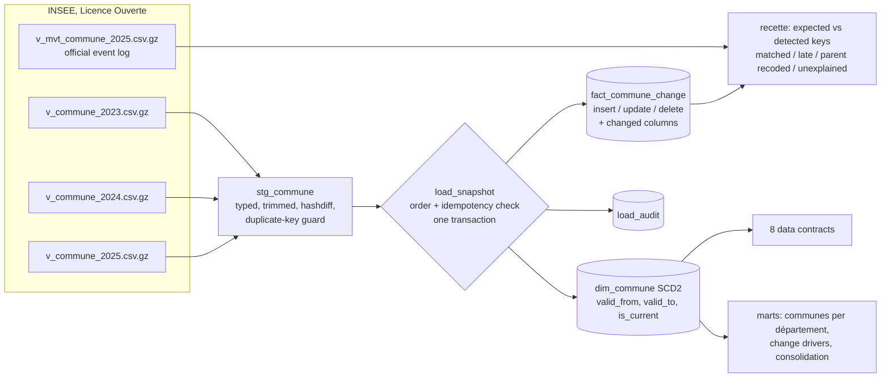

# cogwh: an incremental SCD2 warehouse of French communes, checked against INSEE's event log

[](https://github.com/Adversitas/commune-scd2-warehouse/actions/workflows/ci.yml)

Every year INSEE publishes the *Code Officiel Géographique* (COG): a **full snapshot** of French
communes on 1 January (≈37,500 rows: communes, delegated/associated communes, municipal
arrondissements). Communes merge, get renamed or change canton, and each new file overwrites the
previous one. This project turns the snapshots into a **history**:

- an **incremental Slowly Changing Dimension Type 2** (`dim_commune`) with hashdiff change
  detection, `valid_from` / `valid_to` / `is_current`, idempotent re-runs and an enforced load
  order, loaded in a single transaction per snapshot (a failed load rolls back);
- a **change log fact** (`fact_commune_change`) recording, for every key and snapshot, whether the
  key was inserted, updated or deleted, and **which columns changed**;
- **data contracts** that gate the build: one current version per key, no overlapping validity
  intervals, child communes pointing to a current parent, département code format, and more;
- **BI marts** (point-in-time commune counts per département, change drivers, consolidation);
- an **automated recette against an independent ground truth**: INSEE's official event log
  (`v_mvt_commune`), to prove the incremental load catches every official change;
- the same logic written as a **Snowflake / Databricks `MERGE`** (`sql/snowflake_merge.sql`).

Stack: Python + SQL on DuckDB (columnar, in-process). The SQL uses ANSI patterns that port
directly to Snowflake or Databricks.

## Results (real INSEE COG 2023 → 2024 → 2025)

`cogwh build` on the three yearly files (committed gzipped under `data/raw/`, Licence Ouverte):

| Snapshot | Source rows | Inserted | Updated | Deleted (closed) | Unchanged | Load time |
|---|---|---|---|---|---|---|
| 2023-01-01 (initial) | 37,563 | 37,563 | 0 | 0 | 0 | 0.32 s |
| 2024-01-01 | 37,544 | 21 | 282 | 40 | 37,241 | 0.35 s |
| 2025-01-01 | 37,548 | 101 | 79 | 97 | 37,368 | 0.32 s |

The dimension ends with 38,046 versions. **All 8 data contracts pass.**

**Recette against INSEE's official event log**: every event whose effective date falls between
two snapshots gives keys that *must* change.

| Window | Official events | Keys that must change | Caught (recall) | Detected identity changes | Explained by an event in the window | Late INSEE event | Parent re-coded | Unexplained |
|---|---|---|---|---|---|---|---|---|
| 2023 → 2024 | 75 | 71 | **71 (1.000)** | 81 | 71 | 8 | 2 | **0** |
| 2024 → 2025 | 241 | 233 | **233 (1.000)** | 266 | 233 | 10 | 23 | **0** |

What the data showed:

- **The yearly files lag the event log.** 18 changes come from INSEE events dated *before* the
  previous snapshot that the earlier COG file had not applied yet. For example, the associated
  commune *Richemont* (COMA 16278) was merged on 2020-02-17 but stayed in the COG until the 2024
  file. Without the classification these would look like false positives.
- **Derived changes are real changes.** When a commune nouvelle moves its chef-lieu and changes
  code (event 50, e.g. *Conques-en-Rouergue* 12076 → 12218), all of its delegated communes get a
  new `comparent`. That accounts for 23 extra updates in 2025.
- **Most 2024 updates are not commune events at all.** 262 of the 282 updates are attachment-only
  changes (174 arrondissements, 89 cantons) from the 2024 arrondissement redistricting. They are
  kept in the history but are not counted against the recette.
- Over the two years, the Doubs (25) lost the most communes (571 → 563).

> Honesty note: the "must change" rules were refined once after a first, naive version
> (every key touched by an event must change) scored recall 0.845 / 0.932. Inspecting the misses
> showed they were *absorbing* communes whose own row legitimately stays identical. The rules and
> the reasoning are documented in `src/cogwh/validate.py`.

## Architecture



## How to run

```bash
python -m venv .venv && . .venv/bin/activate      # Windows: .venv\Scripts\activate
pip install -e ".[dev]"

cogwh build                       # loads 2023 -> 2025, contracts, marts, recette -> reports/results.json
cogwh history 16097               # every version of a commune code
cogwh asof 2023-06-01 16097       # what the COG said on a given day

pytest -q && ruff check . && ruff format --check .
```

CI (Python 3.10 and 3.12) runs lint, format, the unit tests (SCD2 counts, idempotency, load
order, rollback on bad input, point-in-time queries, contracts, marts, recette) and then the
**full build on the real data**. A failed contract fails the job.

## Limitations

- Three yearly snapshots only. The dimension has yearly grain, so an event effective on 4 March
  appears at the next 1 January. That is a property of the source, not of the loader.
- The recette uses INSEE's own event log as ground truth. It cannot detect an error that INSEE
  made consistently in both the snapshot and the log.
- DuckDB runs the pipeline here. `sql/snowflake_merge.sql` documents the equivalent `MERGE` but
  is not executed in CI (no Snowflake account in CI).
- Attributes are tracked as strings. Département and région labels are not joined; they would be
  separate conformed dimensions.

## En bref (FR)

Entrepôt de données historisé (SCD de type 2) des communes françaises, construit à partir des
fichiers annuels du Code Officiel Géographique de l'INSEE (2023, 2024, 2025). Le chargement est
incrémental, par hashdiff, idempotent et transactionnel. Il alimente un journal des changements
par colonne, 8 contrats de données bloquants et des datamarts BI. Une recette automatique compare
les changements détectés au journal officiel des événements communaux de l'INSEE : **100 % des
changements attendus sont détectés** et **aucun changement détecté n'est inexpliqué**. Les 18
changements « tardifs » révèlent que les fichiers annuels intègrent certains événements avec
retard. Le SQL est transposable en `MERGE` Snowflake ou Databricks.

## License

MIT for the code. INSEE data: Licence Ouverte / Open Licence 2.0.
